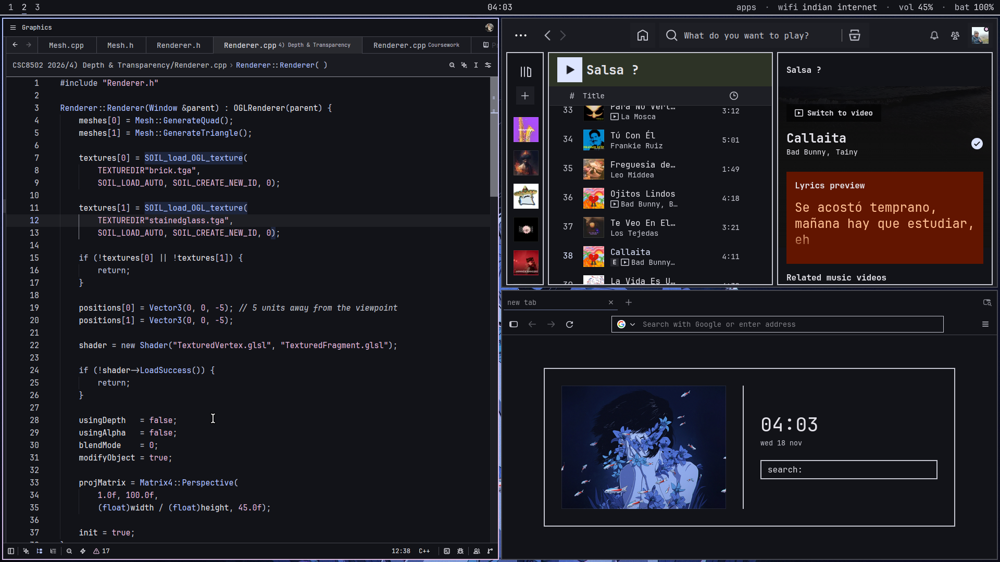
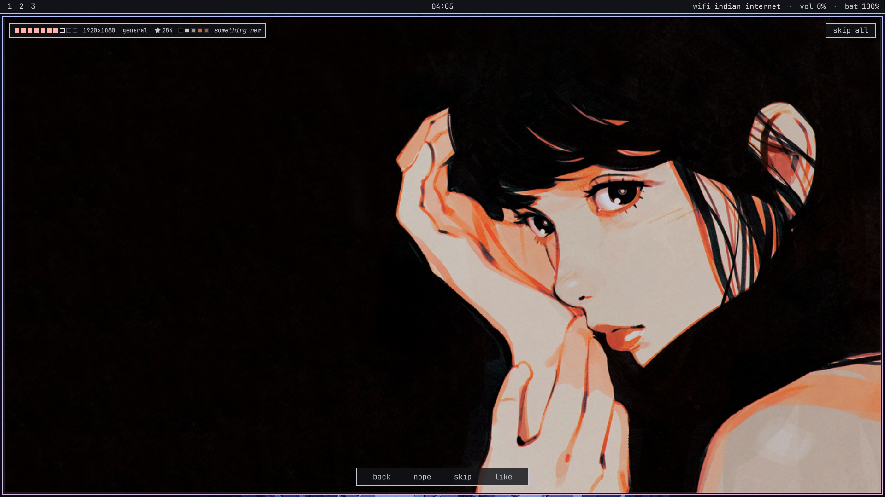

# RiceRiceBaby

First CachyOS rice using Noctalia GTK and Qt. Heavily assisted by Claude Code, but I think it came out consistent!  
Let me know if you have any questions or suggestions for this rice. Enjoy!

## Video Showcase

<p align="center">
  <a href="https://youtu.be/gv0SGaip8lo">
    
  </a>
</p>

## Screenshots







## What's in it

- **OS** : [CachyOS](https://cachyos.org/)
- **WM** : [Hyprland](https://hypr.land/) (lua config)
- **Shell** : [noctalia](https://github.com/noctalia-dev/noctalia-shell) for notifications, control centre and colours
- **Terminal** : [kitty](https://sw.kovidgoyal.net/kitty/) with [fish](https://fishshell.com/)
- **Font** : [JetBrains Mono Nerd Font](https://www.nerdfonts.com/)
- **Apps** : Firefox, Obsidian, Zed, Discord ([Vesktop](https://github.com/Vencord/Vesktop)), Spotify ([Spicetify](https://spicetify.app/)) and all the GTK / Qt apps use the same theme

## Install

Made for **CachyOS + Hyprland**. Plain Arch works too, as long as [paru](https://github.com/Morganamilo/paru) is installed: anything your repositories don't have goes to the AUR through paru.

Everything lives in this one folder. The install script links each config into place; anything already there is kept as `<name>.bak-rice`, and it never overwrites an older backup. With `--packages` it also installs the packages first (it shows the list and asks):

```sh
git clone https://github.com/AdiP1353/dotfiles ~/dotfiles
~/dotfiles/install --packages
```

`~/dotfiles` is the usual place, but any folder works. Run `~/dotfiles/install` without `--packages` to only set things up, or with `--links-only` to only link the files. It's safe to run again.

Then once, with sudo, for the login and lock screen, and to re-apply the theme after pacman updates:

```sh
sudo ~/.config/rice-greeter/install.sh
sudo ~/.config/rice/system/install.sh
```

Log in to Hyprland and pick a wallpaper with `SUPER + W`: every colour comes from it.

## Keeping it in place

`rice check` shows what's themed and what isn't, and `rice apply` puts back whatever is missing. It also runs by itself when you log in, every 6 hours, after Spotify updates, and after pacman updates a themed app. `dots` is git for this folder from anywhere (`dots status`, `dots pull`).

## Not included

- Wallpapers and the terminal picture: they're other people's art, so pick your own.
- A few things specific to my laptop:
  - The Copilot key is bound by its key code (`code:201` in `.config/hypr/config/binds.lua`).
  - Apps open on fixed workspaces (`.config/hypr/config/windowrules.lua`).
  - Open Freeze Center (fan control) only starts on machines that have it.
