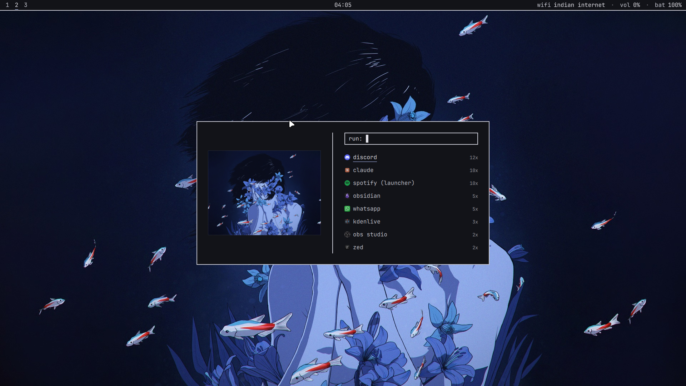
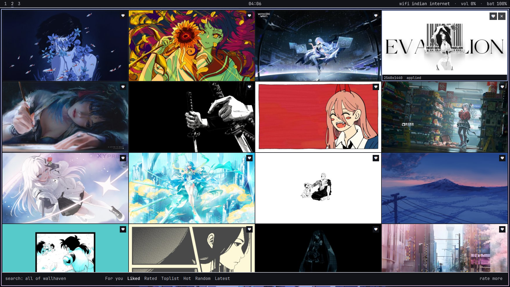

# RiceRiceBaby

First CachyOS rice using Noctalia GTK and Qt. Heavily assisted by Claude Code, but I think it came out consistent!  
Let me know if you have any questions or suggestions for this rice. Enjoy!

## Video Showcase

<p align="center">
  <a href="https://youtu.be/gv0SGaip8lo">
    
  </a>
</p>

### Screenshots







### What's in it

- **OS** : [CachyOS](https://cachyos.org/)
- **WM** : [Hyprland](https://hypr.land/) (lua config)
- **Shell** : [noctalia](https://github.com/noctalia-dev/noctalia-shell) for notifications, control centre and colours
- **Terminal** : [kitty](https://sw.kovidgoyal.net/kitty/) with [fish](https://fishshell.com/)
- **Font** : [JetBrains Mono Nerd Font](https://www.nerdfonts.com/)
- **Apps** : Firefox, Obsidian, Zed, Discord ([Vesktop](https://github.com/Vencord/Vesktop)), Spotify ([Spicetify](https://spicetify.app/)) and all the GTK / Qt apps use the same theme


### Usage

Made for **CachyOS + Hyprland** (plain Arch works too, with paru). Everything lives in this one folder; the install script links each config into place (anything already there is kept as `<name>.bak-rice`) and can install the packages for you (it shows the list and asks first):

```sh
git clone https://github.com/AdiP1353/dotfiles ~/dotfiles
~/dotfiles/install --packages
```

Then once, with sudo, for the login/lock screen and the automatic re-apply after updates:

```sh
sudo ~/.config/rice-greeter/install.sh
sudo ~/.config/rice/system/install.sh
```

Log in to Hyprland and pick a wallpaper with `super w`, every colour comes from it. `rice check` shows that everything is in place.

Not included: wallpapers and the terminal picture (they're other people's art, so pick your own) and a few things specific to my laptop: the Copilot key is bound by its key code (`code:201` in `.config/hypr/config/binds.lua`), and apps open on fixed workspaces (`.config/hypr/config/windowrules.lua`).

### Screenshots


### What's in it

- **OS** : [CachyOS](https://cachyos.org/)
- **WM** : [Hyprland](https://hypr.land/) (lua config)
- **Shell** : [noctalia](https://github.com/noctalia-dev/noctalia-shell) for notifications, control centre and colours
- **Terminal** : [kitty](https://sw.kovidgoyal.net/kitty/) with [fish](https://fishshell.com/)
- **Font** : [JetBrains Mono Nerd Font](https://www.nerdfonts.com/)
- **Apps** : Firefox, Obsidian, Zed, Discord ([Vesktop](https://github.com/Vencord/Vesktop)), Spotify ([Spicetify](https://spicetify.app/)) and all the GTK / Qt apps use the same theme


### Usage

Everything is in this one folder. Clone it to `~/dotfiles` and run the install script, it links every config into place (backing up anything already there) and sets up the rest:

```sh
git clone https://github.com/AdiP1353/dotfiles ~/dotfiles
~/dotfiles/install
```

For the login screen run `sudo ~/.config/rice-greeter/install.sh`, and `sudo ~/.config/rice/system/install.sh` to re-apply the theme after pacman updates.
