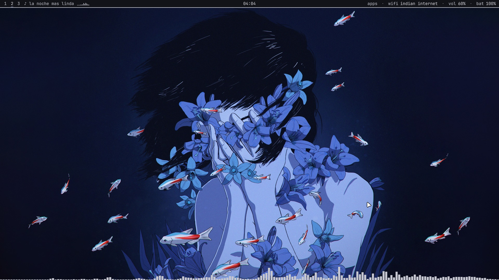

# RiceRiceBaby

First CachyOS rice using Noctalia GTK and Qt. Heavily assisted by Claude Code, but I think it came out consistent!  
Let me know if you have any questions or suggestions for this rice. Enjoy!

## Video Showcase

  

### Screenshots

### What's in it

- **OS** : [CachyOS](https://cachyos.org/)
- **WM** : [Hyprland](https://hypr.land/) (lua config)
- **Shell** : [noctalia](https://github.com/noctalia-dev/noctalia-shell) for notifications, control centre and colours
- **Terminal** : [kitty](https://sw.kovidgoyal.net/kitty/) with [fish](https://fishshell.com/)
- **Font** : [JetBrains Mono Nerd Font](https://www.nerdfonts.com/)
- **Apps** : Firefox, Obsidian, Zed, Discord ([Vesktop](https://github.com/Vencord/Vesktop)), Spotify ([Spicetify](https://spicetify.app/)) and all the GTK / Qt apps use the same theme

### Usage

Copy what you want into `~/.config`. Back up your own configs first.

Then run `~/.config/rice/bin/rice install`. It sets everything up and keeps the theme in place after updates (`rice check` shows what's themed).

For the login screen run `sudo ~/.config/rice-greeter/install.sh`, and `sudo ~/.config/rice/system/install.sh` to re-apply the theme after pacman updates.
