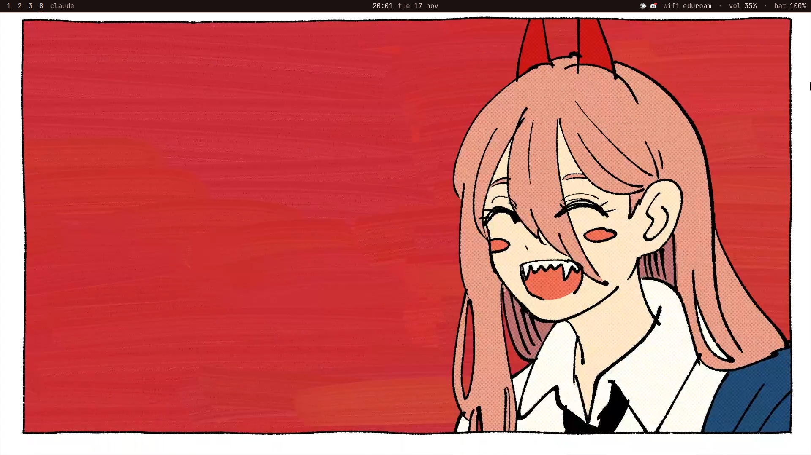
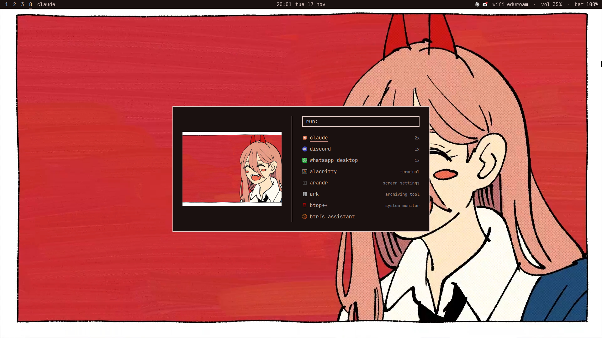
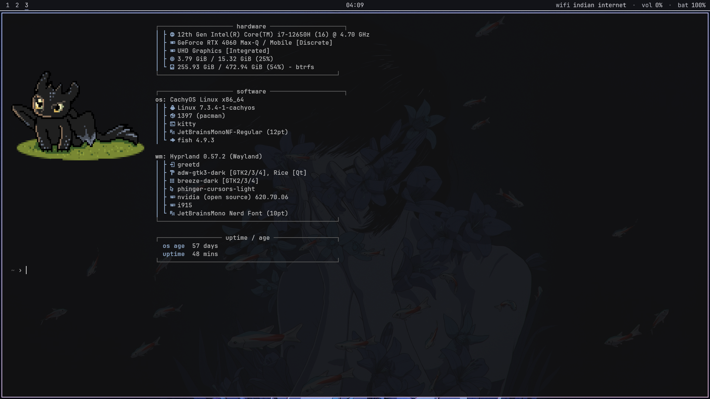

# dotfiles

My CachyOS rice. Super minimal, the colours come from the wallpaper.

### What's in it

- **OS** : [CachyOS](https://cachyos.org/)
- **WM** : [Hyprland](https://hypr.land/) (lua config)
- **Shell** : [noctalia](https://github.com/noctalia-dev/noctalia-shell) for notifications, control centre and colours
- **Bar, launcher, alt tab** : my own, made with [Quickshell](https://quickshell.org/)
- **Wallpaper picker** : also mine, pulls straight from [wallhaven](https://wallhaven.cc/) and learns what I like
- **Login / lock screen** : my own greetd greeter, looks like [Ly](https://github.com/fairyglade/ly)
- **Terminal** : [kitty](https://sw.kovidgoyal.net/kitty/) with [fish](https://fishshell.com/)
- **Fetch** : [fastfetch](https://github.com/fastfetch-cli/fastfetch)
- **Font** : [JetBrains Mono Nerd Font](https://www.nerdfonts.com/)
- **Apps** : Firefox, Obsidian, Zed, Discord ([Vesktop](https://github.com/Vencord/Vesktop)), Spotify ([Spicetify](https://spicetify.app/)) and all the GTK / Qt apps use the same theme
- **Wallpaper** : [wallhaven-exoldw](https://wallhaven.cc/w/exoldw)

Everything follows one style, it's written down in [THEME.md](../.config/rice/THEME.md).

### Keys

- `super space` app launcher
- `super w` wallpapers
- `super p` display mode
- `super l` lock
- `super h` all the other shortcuts
- `alt tab` switch windows

### Usage

Copy what you want into `~/.config`. Back up your own configs first.

Then run `~/.config/rice/bin/rice install`. It sets everything up and keeps the theme in place after updates (`rice check` shows what's themed).

For the login screen run `sudo ~/.config/rice-greeter/install.sh`, and `sudo ~/.config/rice/system/install.sh` to re-apply the theme after pacman updates.

### Screenshots

